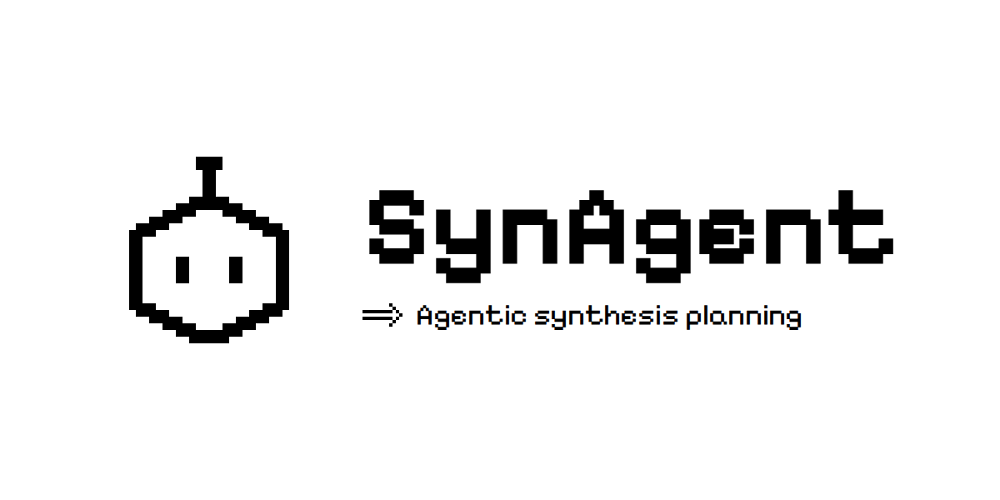

<div align="center">
    <picture>
        <source media="(prefers-color-scheme: dark)" srcset="assets/synagent-lockup-inverted.png">
        
    </picture>
</div>

Agentic retrosynthesis planning and synthetic pathway reconstruction interfaced with [SynLlama](https://github.com/THGLab/SynLlama).

<div align="center">
    
</div>

(a) SynLlama proposes a route and an agent refines and validates it (`synagent run generation`, then `validation`).
(b) A co-planning agent calls SynLlama as a tool while chatting (`synagent serve` or `cli`).
(c) The validation and optimizer agents loop until the route passes (`synagent run pipeline`).

## Installation

```sh
# 1. Clone the repo
git clone https://github.com/lukasmki/SynAgent.git
cd SynAgent

# 2. Setup virtual environment
## if you have `uv` installed
uv sync

## if you don't, create venv manually
python3 -m venv .venv
source .venv/bin/activate
pip install .

# 3. Verify installation
synagent --help

# 4. Configure environment
cp .env.sample .env   # then fill in VLLM_BASE_URL and any API keys you need
```

The default config runs on the bundled vLLM servers in [`vllm/`](vllm/)
(see [`vllm/config.yaml`](vllm/config.yaml)), started on a 4-GPU node with
`vllm/start.sh`. Set `VLLM_BASE_URL` in `.env` to the agent model's endpoint,
`http://<gpu-node>:8000/v1`. The API keys are only needed for models from those
providers.

## Configuring the agent

SynAgent is built from [pydantic-ai agent specs](https://pydantic.dev/docs/ai/core-concepts/agent-spec/).
The default config is [`src/synagent/specs/synagent.yaml`](src/synagent/specs/synagent.yaml):

```yaml
model: vllm:google/gemma-4-26B-A4B-it  # served at VLLM_BASE_URL
instructions: You are SynAgent, a synthesis planning assistant. ...
capabilities:
  - AnalogueSearch
  - Generation: {synllama_url: "http://localhost:8002/v1"}  # set capability fields
  - SubAgents:
      agents:
        - validator.yaml                    # relative to this spec file
        - path: retriever.yaml
          timeout_seconds: 300               # optional per-delegate run controls
```

- Each `SubAgents` entry is another spec file. Sub-agent specs that leave out
  `model` run on the parent's model.
- To use a different configuration, copy the specs and pass `--spec` to
  `serve`, `cli`, or `run`.
- `--model` overrides the spec's `model`, for example
  `--model google:gemini-3-flash-preview`.
- `synagent schema` regenerates `synagent_schema.json` for editor autocompletion.

## Usage

### Interactive REPL

```sh
synagent                                       # bare invocation, default spec
synagent cli                                   # same, but accepts flags
synagent cli --model anthropic:claude-sonnet-5
```

Tool calls and thinking stream as the agent works. Inside the REPL: `/help` shows
the commands, `/clear` resets the conversation history, and `exit` (or `quit`,
`/exit`, Ctrl-C) quits.

### Web server

```sh
synagent serve                                 # http://localhost:8000
synagent serve --host 0.0.0.0 --port 8080
```

### Workflows

`synagent run <workflow> <request>` runs one of the predefined workflows and prints
the resulting model as JSON on stdout.

| Workflow | Input | Output |
| --- | --- | --- |
| `generation` | natural-language request | `SynLlamaFormat` synthesis path |
| `validation` | `SynLlamaFormat` JSON | `ValidationReport` |
| `correction` | `ValidationReport` JSON | corrected `ValidationReport` |
| `pipeline` | natural-language request | `ValidationReport` (generate → validate → correct, up to 4 iterations) |

```sh
# Plan a route from a natural-language request
synagent run generation "Synthesize ibuprofen from commercially available blocks"

# Generate, validate, then self-correct until the route is valid
synagent run pipeline "Propose a 3-step route to celecoxib" > report.json
```

Note that `validation` and `correction` take a JSON document rather than prose —
they are the individual stages of `pipeline`, meant to be chained:

```sh
synagent run generation "Route to aspirin" > route.json
synagent run validation "$(cat route.json)" > report.json
synagent run correction "$(cat report.json)"
```

A `SynLlamaFormat` path, the input `validation` expects, looks like this:

```json
{
  "reactions": [
    {
      "reaction_number": 1,
      "reaction_template": "[OH:1][c:2].[Cl:3][C:4]=[O:5]>>[O:1]([c:2])[C:4]=[O:5]",
      "reactants": ["Oc1ccccc1C(=O)O", "CC(=O)Cl"],
      "product": "CC(=O)Oc1ccccc1C(=O)O"
    }
  ],
  "building_blocks": ["Oc1ccccc1C(=O)O", "CC(=O)Cl"]
}
```

### Tracing

`serve`, `cli`, and `run` all accept the same observability flags.

```sh
# JSONL trace under .synagent/traces/YYYY-MM-DD/<HHMMSS>-<pid>.jsonl
synagent run pipeline "Route to aspirin" --trace

# Explicit destination; --trace-path implies --trace
synagent cli --trace-path runs/session.jsonl

# Send spans to Logfire as well
synagent serve --logfire --trace
```

`--trace-path` accepts either a `.jsonl` file, used verbatim, or a directory, in
which case a timestamped file is created inside it. Traces record every model
request/response pair, including sub-agent runs, linked to the parent by run id.

### Exporting traces

`synagent trace export` converts traces into a chat-format supervised fine-tuning
dataset.

```sh
synagent trace export '.synagent/traces/**/*.jsonl' -o dataset.jsonl

# Only trajectories that produced a valid route, main agent only
synagent trace export '.synagent/traces/**/*.jsonl' -o dataset.jsonl \
    --only-successful --agent synagent --min-steps 2
```

Quote the glob so it reaches the CLI rather than being expanded by the shell.
`--agent` filters to one agent's calls by its spec `name` — `synagent` (the main
agent), or a sub-agent such as `validator` or `retriever` — and
`--include-thinking` keeps thinking content as `reasoning_content` on each target.
