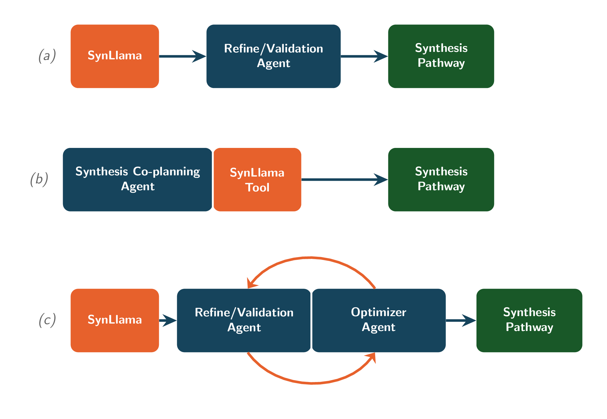

# SynAgent

Agentic retrosynthesis planning and synthetic pathway reconstruction interfaced with [SynLlama](https://github.com/THGLab/SynLlama).

<div align="center">
    
</div>

## Installation

```sh
# 1. Clone the repo
git clone https://github.com/lukasmki/SynAgent.git
cd SynAgent

# 2. Setup virtual environment
## if you have `uv` installed
uv sync

## if you don't, create venv manually
python3 -m venv .venv
source .venv/bin/activate
pip install .

# 3. Verify installation
synagent --help
```

## Configuring the agent

SynAgent is built from [pydantic-ai agent specs](https://pydantic.dev/docs/ai/core-concepts/agent-spec/).
The default spec is [`src/synagent/specs/synagent.yaml`](src/synagent/specs/synagent.yaml):

```yaml
model: google:gemini-3-flash-preview
instructions: You are SynAgent, a synthesis planning assistant. ...
capabilities:
  - AnalogueSearch
  - Generation: {synllama_url: "http://localhost:8002/v1"}  # set capability fields
  - SubAgents:
      agents:
        - validator.yaml                    # relative to this spec file
        - path: retriever.yaml
          timeout_seconds: 300               # optional per-delegate run controls
```

- Each `SubAgents` entry is another spec file. Sub-agent specs that leave out
  `model` run on the parent's model.
- To use a different configuration, copy the specs and pass `--spec` to
  `serve`, `cli`, or `run`.
- `--model` overrides the spec's `model`, for example
  `--model vllm:google/gemma-4-26B-A4B-it`.
- `synagent schema` regenerates `synagent_schema.json` for editor autocompletion.
